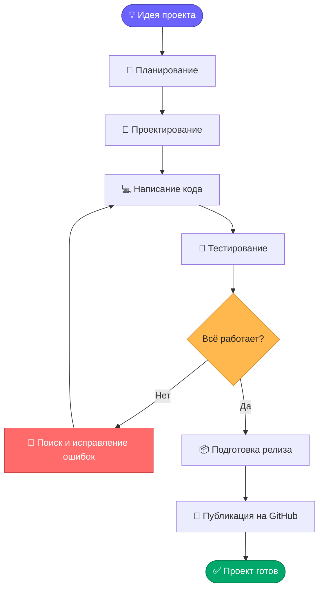

<div align="center">

# 👨💻 Иван | Developer

### Привет! Добро пожаловать в мой GitHub 🚀

**Программист • Разработчик • Энтузиаст технологий**

<p>
  
  
  
</p>

</div>

---

## 🧑🚀 Обо мне

Привет! Меня зовут **Иван**, я программист, который изучает новые технологии, создаёт проекты и совершенствует свои навыки разработки.

💡 Мне нравится превращать идеи в работающие приложения, экспериментировать с технологиями и решать интересные задачи.

- 💻 Изучаю программирование и разработку приложений.
- 🛠️ Создаю проекты для практики и развития навыков.
- 📚 Постоянно изучаю новые инструменты и технологии.
- 🎯 Стремлюсь писать понятный, структурированный и качественный код.
- 🚀 Открыт для новых идей и интересных проектов.

---

## 🧰 Технологии и инструменты

<p align="center">
  
</p>

> Список технологий можно изменить в зависимости от того, с какими языками и инструментами Иван действительно работает.

---

## 📊 Как проходит разработка проекта?

Ниже представлена схема рабочего процесса программиста, созданная с помощью **Mermaid**.



---

## 🗂️ Структура репозитория

Пример организации проекта:

```text
ivan-project/
├── 📁 src/              # Исходный код
├── 📁 assets/           # Изображения и ресурсы
├── 📁 docs/             # Документация
├── 📁 tests/            # Тесты
├── 📄 .gitignore        # Игнорируемые файлы
├── 📄 LICENSE           # Лицензия проекта
└── 📄 README.md         # Описание проекта
```

_Структуру можно адаптировать под конкретный язык и тип приложения._

---

## 🎯 Мои цели

- [ ] 📚 Освоить новые технологии программирования.
- [ ] 🛠️ Разработать несколько полноценных проектов.
- [ ] 🧪 Улучшить навыки тестирования и отладки.
- [ ] 🌐 Научиться создавать качественные веб-приложения.
- [ ] 🤝 Принять участие в командной разработке Open Source.

---

## 📈 Мой подход к разработке

| Принцип                | Описание                                         |
| ---------------------- | ------------------------------------------------ |
| 🧹 Чистый код          | Пишу код, который удобно читать и поддерживать   |
| 🔍 Внимание к деталям  | Проверяю работу функций и исправляю ошибки       |
| 📖 Постоянное обучение | Изучаю новые технологии и практики               |
| 🤝 Командная работа    | Использую Git и GitHub для совместной разработки |
| 🚀 Развитие            | Стараюсь улучшать каждый следующий проект        |

---

## 🐍 GitHub Contribution Graph

<div align="center">


</div>

---

## 📬 Контакты

Если у вас есть идеи для совместных проектов или предложения по сотрудничеству, буду рад общению!

- 🐙 **GitHub:** [Мой профиль](https://github.com/)

---

<div align="center">

### 💻 Code. Learn. Build. Repeat.

_Каждый проект — это новый опыт, каждая ошибка — возможность стать лучше._

⭐ Если вам понравились мои проекты, не забудьте поставить звезду!

</div>
